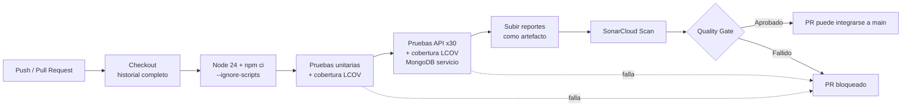

# Caso de Estudio #3: Integración y Despliegue Continuo con SonarCloud

BISOFT-17 Calidad, Verificación y Validación de Software, Universidad CENFOTEC.

Proyecto: Distrito Cosmético (API Express + MongoDB, SPA Vue 3).

## 1. Herramientas seleccionadas y justificación

| Herramienta | Uso | Justificación |
| --- | --- | --- |
| **GitHub Actions** | Orquesta el pipeline de CI/CD. | El repositorio ya está en GitHub, por lo que no requiere infraestructura adicional. Es gratuito para repositorios públicos, el workflow vive en el propio repositorio (`.github/workflows/build.yml`) y se integra de forma nativa con los pull requests y la protección de ramas. |
| **SonarCloud** | Análisis estático: bugs, vulnerabilidades, code smells, duplicación y cobertura. | Es la versión alojada de SonarQube y usa el mismo motor y las mismas reglas. Es gratuito para repositorios públicos, no requiere servidor propio y publica el Quality Gate como check del PR. |
| **Node.js Test Runner** | Pruebas unitarias del backend (`test/unit/`). | Viene con Node 20+, sin dependencias adicionales, y genera cobertura en formato LCOV. |
| **Vitest + Axios** | 30 pruebas funcionales de API (`test/api-tests/`). | Ejecuta solicitudes HTTP reales contra Express y una base MongoDB temporal. Genera reporte JUnit y cobertura V8 en LCOV. |
| **MongoDB 7 (contenedor de servicio)** | Base de datos de las pruebas en CI. | Se levanta como `service` del job, sin datos sensibles ni credenciales. |

## 2. Flujo del pipeline

El workflow se ejecuta en cada `push` a `main` y en cada pull request (abierto, actualizado o reabierto).

Pasos del job `Tests y SonarCloud` (`ubuntu-latest`):

1. `actions/checkout` con `fetch-depth: 0`, necesario para que Sonar atribuya correctamente el código nuevo.
2. `actions/setup-node` (Node 24, caché de npm) y `npm ci --ignore-scripts`. El flag evita ejecutar scripts de ciclo de vida de dependencias (regla S6505 de Sonar).
3. `npm run test:coverage`: pruebas unitarias y `reports/unit/lcov.info`.
4. `npm run test:api:coverage`: 30 pruebas API, `reports/api/junit.xml` y `reports/api/coverage/lcov.info`.
5. `actions/upload-artifact`: publica `reports/` aunque alguna prueba falle.
6. `SonarSource/sonarqube-scan-action`: envía código y ambos LCOV a SonarCloud.

Configuración relevante:

- Secrets del repositorio: `SONAR_TOKEN` y `JWT_SECRET`. `MONGODB_URI` va como variable del workflow, apuntando al contenedor.
- `sonar-project.properties`: fuentes `src` y `distrito-cosmetico-frontend/src`; pruebas en `test`; los dos reportes LCOV en `sonar.javascript.lcov.reportPaths`.
- Se desactivó *Automatic Analysis* en SonarCloud: no puede coexistir con el análisis por CI y no recibe cobertura.

Un fallo en cualquier paso, ya sea una prueba o el Quality Gate, marca el check del PR en rojo. Con la protección de rama activada, ese check obligatorio impide la integración a `main`.

## 3. Evidencias de ejecución

Capturas de pantalla (guardar en `docs/evidencias/`):

| # | Evidencia | Archivo |
| --- | --- | --- |
| 1 | Ejecución del workflow en verde en la pestaña Actions. | `01-actions-verde.png` |
| 2 | Detalle del job: pruebas unitarias y 30 pruebas API aprobadas. | `02-job-pruebas.png` |
| 3 | Artefacto `reportes-pruebas` publicado. | `03-artefacto.png` |
| 4 | Dashboard de SonarCloud con Quality Gate. | `04-sonar-dashboard.png` |
| 5 | Comentario de SonarCloud en el pull request. | `05-sonar-pr.png` |
| 6 | Ejecución fallida inicial y su corrección (opcional). | `06-fallo-corregido.png` |

Historial de ejecuciones (verificable con `gh run list`):

- Fallo: Quality Gate en rojo por *Security Rating C*, causado por `npm ci` sin `--ignore-scripts` (S6505).
- Fallo: error `ENOENT reports/unit/lcov.info`, porque el directorio no existía en CI.
- Fallo: *Automatic Analysis* de SonarCloud activo junto al análisis por CI.
- Éxito en el PR #2 y en el `push` a `main` posterior.

## 4. Análisis de resultados

### 4.1 Pruebas

- 30 de 30 pruebas API aprobadas y todas las pruebas unitarias aprobadas en las ejecuciones finales del pipeline.
- Las pruebas corren sin intervención manual y en un entorno limpio (base temporal y contenedor propio), lo que elimina el "en mi máquina funciona".

### 4.2 Métricas de SonarCloud sobre `main`

| Métrica | Valor |
| --- | --- |
| Líneas de código (ncloc) | 5188 |
| Cobertura total | 69,2 % |
| Cobertura de líneas | 70,7 % |
| Duplicación | 1,0 % |
| Bugs | 1 |
| Vulnerabilidades | 5 |
| Code smells | 2 |
| Security hotspots | 0 |
| Mantenibilidad | A |
| Fiabilidad | C |
| Seguridad | E |

El Quality Gate del PR #2 quedó en **Aprobado**: sin issues nuevos y con calificación A en fiabilidad, seguridad y mantenibilidad sobre el código nuevo. Las calificaciones de `main` reflejan en cambio el código **previo** al pipeline, que ahora queda visible.

### 4.3 Hallazgos sobre el código existente

| Tipo | Severidad | Regla | Ubicación | Descripción |
| --- | --- | --- | --- | --- |
| Vulnerabilidad | Bloqueante | S5147 | `product.controller.js` (líneas 24, 53, 69), `cart.controller.js:29` | Inyección NoSQL: datos del usuario llegan a consultas Mongo sin sanear. |
| Vulnerabilidad | Crítica | S4684 | `product.controller.js:58` | Asignación masiva: el cuerpo de la solicitud se aplica al modelo sin filtrar campos. |
| Bug | Mayor | S9383 | `server.js:68` | Promesa sin `await` ni manejo de rechazo. |
| Code smell | Mayor | S8786 | `auth.controller.js:9` | Expresión regular con backtracking de rendimiento super-lineal. |
| Code smell | Bloqueante | S2187 | `api.test.mjs` | Archivo sin llamadas directas a `test()`. Probable falso positivo: los casos se registran desde módulos auxiliares. |

Nota: `test/unit/security.test.js` ya comprueba que los operadores MongoDB se rechazan en el login. Los hallazgos S5147 señalan otros puntos de entrada donde esa validación no se aplica.

### 4.4 Cobertura

Las pruebas API cubren el 66,9 % de las líneas de `src/` y las unitarias el 64,0 %. Quedan sin cubrir sobre todo `currency.service.js` (consumo de la API externa) y parte de `auth.js` y `server.js`. El frontend se excluyó de la métrica de cobertura porque no tiene pruebas automatizadas, pero sí se analiza estáticamente.

## 5. Conclusiones

1. **Detección temprana.** El pipeline detectó problemas desde el primer PR: una vulnerabilidad en el propio workflow y, al analizar `main`, cinco vulnerabilidades y un bug en el código de la aplicación que las pruebas funcionales no habían revelado. Las pruebas verifican el comportamiento esperado; el análisis estático encuentra defectos de diseño y seguridad.
2. **Trazabilidad.** Cada ejecución queda ligada a un commit y a un PR, con reportes JUnit, LCOV y el dashboard de Sonar como evidencia consultable.
3. **Calidad como condición de integración.** Con el check obligatorio en `main`, un PR con pruebas rotas o con un Quality Gate fallido no puede fusionarse.
4. **El Quality Gate por defecto evalúa código nuevo.** Por eso el PR #2 pasó aunque `main` tiene issues previos. Esos hallazgos deben tratarse como deuda técnica con un plan de corrección.
5. **Mejoras propuestas:**
   - Sanear las entradas de productos y carrito (convertir a tipos primitivos o usar `mongoose.sanitizeFilter`) y filtrar los campos permitidos al actualizar productos.
   - Manejar el rechazo de la promesa en `server.js`.
   - Subir la cobertura de `currency.service.js` simulando la API externa.
   - Agregar pruebas al frontend (por ejemplo con Vitest y Vue Test Utils).
   - Añadir un paso de despliegue (CD) a un entorno de staging cuando se disponga de uno.

**Alcance del CD.** El pipeline implementado cubre integración continua con verificación automática y bloqueo de integración. El despliegue automático no se implementó porque el proyecto no cuenta con un entorno de destino.
